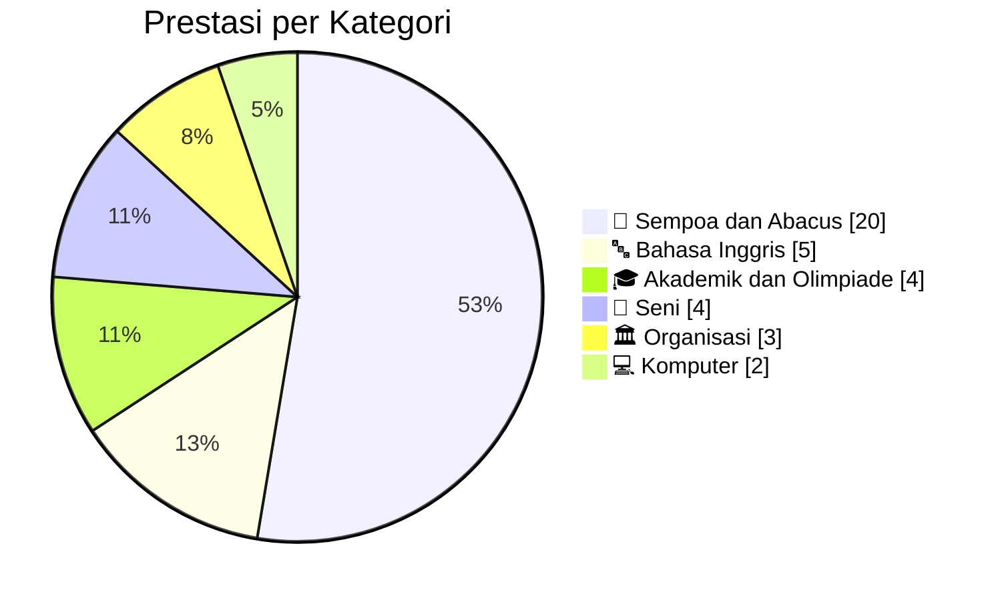
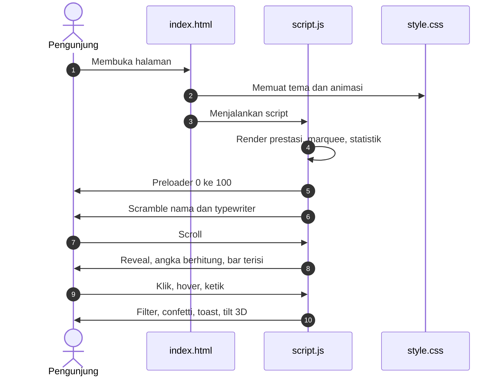

<div align="center">


<br/>

**Website portofolio pribadi yang dibangun dengan HTML, CSS, dan JavaScript murni.**
<br/>
Tanpa framework. Tanpa dependensi. Cukup buka `index.html` dan semuanya hidup.

<br/>

[](https://dfandkaa.github.io/portofolio/)
[](#-lisensi)
[](#-teknologi)


<br/>


</div>

<br/>

<div align="center">

### ✦ Navigasi Cepat ✦

[**Tentang**](#-tentang-proyek) · [**Preview**](#-preview) · [**Fitur**](#-fitur-unggulan) · [**Section**](#-isi-website) · [**Teknologi**](#-teknologi) · [**Struktur**](#-struktur-proyek) · [**Cara Pakai**](#-cara-menjalankan) · [**Kustomisasi**](#-kustomisasi) · [**Deploy**](#-deploy-gratis) · [**Easter Egg**](#-easter-egg) · [**Kontak**](#-kontak)

</div>


## ✦ Tentang Proyek

Ini adalah website portofolio saya, **Dafa Dwi Andika**, mahasiswa **S1 Ilmu Komputer Universitas Sumatera Utara** (stambuk 2026). Website ini merangkum perjalanan saya dari sempoa, olimpiade, bahasa Inggris, seni, hingga organisasi dan dunia usaha, lalu dikemas dengan tampilan bertema **navy dan emas** yang elegan.

Seluruh efeknya (latar konstelasi, kursor kustom, foto 3D, confetti, dan lain-lain) ditulis **dari nol** tanpa library apa pun. Kodenya sengaja dibuat ringan dan rapi supaya mudah dibaca dan dipelajari.

> 💡 **Filosofi desain:** tampil mewah tetapi tetap ringan. Satu `index.html`, satu `style.css`, satu `script.js`. Itu saja.

<table>
<tr>
<td align="center"><b>3</b><br/><sub>file utama</sub></td>
<td align="center"><b>0</b><br/><sub>library eksternal</sub></td>
<td align="center"><b>8</b><br/><sub>section halaman</sub></td>
<td align="center"><b>38</b><br/><sub>prestasi tercatat</sub></td>
<td align="center"><b>2</b><br/><sub>tema warna</sub></td>
</tr>
</table>


## ✦ Preview

> 📸 Letakkan tangkapan layar di folder `assets/` lalu ganti jalur gambar di bawah ini.

<div align="center">

| 🌙 Mode Gelap | ☀️ Mode Terang |
|:---:|:---:|
|  |  |

| 📱 Tampilan HP | 🏆 Section Prestasi |
|:---:|:---:|
|  |  |

</div>

<details>
<summary><b>🎬 Cara cepat membuat GIF demo (klik untuk buka)</b></summary>

<br/>

1. Buka website di browser, lalu rekam layar dengan **ScreenToGif** (Windows) atau **Kap** (macOS).
2. Rekam sekitar 10 sampai 15 detik: preloader, efek acak nama, scroll, filter prestasi, ganti tema.
3. Simpan sebagai `assets/demo.gif`, lalu tambahkan baris ini di README:

```markdown

```

</details>


## ✦ Fitur Unggulan

Klik tiap bagian untuk melihat detailnya.

<details open>
<summary><b>🎬 Animasi dan Efek Visual</b></summary>

<br/>

| Efek | Deskripsi | Teknik |
|---|---|---|
| ⏳ **Preloader** | Penghitung 0 sampai 100 persen sebelum website tampil | `setInterval` dan kelas `.go` |
| 🔤 **Scramble nama** | Huruf nama berputar acak lalu mengunci satu per satu | `setInterval` per karakter |
| ⌨️ **Typewriter** | Peran bergantian: Mahasiswa Ilmu Komputer USU, Ketua English Club, Koordinator Olimpiade, Calon Full Stack Developer | Rekursi `setTimeout` |
| ✨ **Latar konstelasi** | Titik-titik emas saling terhubung dan **menjauh dari kursor** | `<canvas>` dan `requestAnimationFrame` |
| 🖱️ **Kursor kustom** | Titik dan cincin yang mengikuti dengan halus, membesar saat menyentuh elemen interaktif | Interpolasi linear (lerp) |
| 🧊 **Foto 3D** | Foto miring mengikuti arah mouse | CSS `rotateX` dan `rotateY` via JS |
| 🧲 **Tombol magnetik** | Tombol tertarik sedikit ke arah kursor | `mousemove` dan `translate` |
| 💡 **Spotlight kartu** | Cahaya lembut di dalam kartu mengikuti posisi kursor | Variabel CSS `--mx` dan `--my` |
| 🔢 **Angka berhitung** | Statistik naik dari 0 ke nilai akhir dengan easing halus | `IntersectionObserver` dan easing kubik |
| 📊 **Bar keahlian** | Bar terisi saat section masuk layar | Atribut `data-v` |
| 📈 **Garis timeline** | Garis emas di Pendidikan terisi mengikuti scroll | Hitungan `getBoundingClientRect` |
| 🎞️ **Reveal saat scroll** | Elemen muncul bertahap dengan jeda | Kelas `.rv` dan `--d` |
| 🪧 **Marquee** | Kata kunci keahlian berjalan tanpa henti | CSS `@keyframes marquee` |
| 🎉 **Confetti** | Ledakan kertas emas saat segel nilai diklik | Canvas partikel dengan gravitasi |

</details>

<details>
<summary><b>🕹️ Interaksi dan Kontrol</b></summary>

<br/>

- 🌗 **Ganti tema** gelap atau terang dengan satu klik (ikon ☾ dan ☀).
- 📱 **Menu hamburger** otomatis muncul di layar kecil dan menutup sendiri setelah memilih tautan.
- 🧭 **Menu aktif**: tautan navigasi menyala sesuai section yang sedang dibaca.
- 📏 **Progress bar** tipis di atas layar menunjukkan seberapa jauh halaman sudah dibaca.
- ⬆️ **Tombol ke atas** muncul setelah scroll melewati 600 piksel.
- 🍞 **Toast** kecil memberi umpan balik (email disalin, nilai rata-rata, dan sebagainya).
- 📋 **Salin email** dengan satu klik memakai Clipboard API.
- ✉️ **Formulir kontak** menyusun email otomatis (`mailto:`) berisi nama dan pesan.
- 🎯 **Segel nilai 95,84** di samping foto bisa diklik untuk memicu confetti.

</details>

<details>
<summary><b>🏆 Etalase Prestasi Interaktif</b></summary>

<br/>

Section **Prestasi** dirender otomatis dari sebuah array data di `script.js`. Pengunjung bisa:

| Kontrol | Fungsi |
|---|---|
| 🏷️ **Chip kategori** | Menyaring berdasarkan kategori (Sempoa, Akademik, Bahasa Inggris, Seni, Komputer, Organisasi) |
| 📅 **Dropdown tahun** | Menyaring berdasarkan tahun perlombaan |
| 🔍 **Kotak pencarian** | Mencari judul, acara, kota, atau tanggal secara langsung |
| ➕ **Tampilkan lebih banyak** | Memuat 12 prestasi lagi, lengkap dengan sisa jumlahnya |

Semua kontrol bisa **dikombinasikan**. Statistik di atasnya (total pencapaian, medali emas dan juara 1, jumlah kategori) **dihitung otomatis** dari data, jadi tidak perlu diubah manual.

Teks dari data juga dilewatkan fungsi `escapeHtml()` sebelum masuk ke HTML supaya aman.

</details>

<details>
<summary><b>🎨 Desain dan Aksesibilitas</b></summary>

<br/>

- 🏛️ Tipografi berkelas: **Cormorant Garamond** untuk judul dan **Manrope** untuk teks isi.
- 🌓 Dua tema lengkap lewat variabel CSS dan atribut `data-theme`.
- 📐 Layout responsif dengan breakpoint untuk layar sempit (≤ 820 px).
- 👆 Aturan khusus perangkat sentuh (`hover: none`) supaya efek kursor tidak mengganggu di HP.
- 🐢 Mendukung `prefers-reduced-motion` bagi pengunjung yang menghindari animasi berlebih.
- 🏷️ Atribut `aria-label` pada tombol ikon dan `alt` pada foto.
- 🌐 `lang="id"` dan meta viewport sudah diatur dengan benar.

</details>


## ✦ Isi Website

Website terdiri atas **delapan section** yang saling terhubung lewat navigasi tetap di atas.

```mermaid
flowchart LR
    A([🏠 Beranda]) --> B([👤 Tentang])
    B --> C([🎓 Pendidikan])
    C --> D([🏛️ Organisasi])
    D --> E([💼 Kerja])
    E --> F([🛠️ Keahlian])
    F --> G([🏆 Prestasi])
    G --> H([📬 Kontak])

    style A fill:#0a1330,stroke:#d4af62,color:#f0dba5
    style B fill:#101c40,stroke:#d4af62,color:#f0dba5
    style C fill:#101c40,stroke:#d4af62,color:#f0dba5
    style D fill:#101c40,stroke:#d4af62,color:#f0dba5
    style E fill:#101c40,stroke:#d4af62,color:#f0dba5
    style F fill:#101c40,stroke:#d4af62,color:#f0dba5
    style G fill:#101c40,stroke:#d4af62,color:#f0dba5
    style H fill:#0a1330,stroke:#d4af62,color:#f0dba5
```



| # | Section | ID | Isi singkat |
|:-:|---|---|---|
| 1 | 🏠 **Beranda** | `#home` | Nama dengan efek scramble, peran yang diketik otomatis, foto 3D, dan segel nilai |
| 2 | 👤 **Tentang** | `#about` | Profil singkat dan empat statistik yang berhitung |
| 3 | 🎓 **Pendidikan** | `#edu` | Timeline TK sampai S1 dengan garis emas yang terisi saat scroll |
| 4 | 🏛️ **Organisasi** | `#org` | Kartu pengalaman dengan filter jenjang (SMA / SMP) |
| 5 | 💼 **Kerja** | `#work` | Pengalaman mengelola keuangan dan operasional toko |
| 6 | 🛠️ **Keahlian** | `#skill` | Bar keahlian teknis dan pribadi yang beranimasi |
| 7 | 🏆 **Prestasi** | `#proj` | Sorotan utama dan etalase 38 prestasi dengan filter dan pencarian |
| 8 | 📬 **Kontak** | `#contact` | Email, WhatsApp, tombol salin, dan formulir pesan |


## ✦ Statistik Prestasi

Data di bawah ini dihitung langsung dari array prestasi di `script.js`.

<div align="center">

| 🏅 Total | 🥇 Emas / Juara 1 | 🥈 Perak | 🥉 Perunggu | ⭐ Penghargaan lain |
|:-:|:-:|:-:|:-:|:-:|
| **38** | **17** | **9** | **3** | **9** |

</div>



<details>
<summary><b>📅 Lihat sebaran prestasi per tahun</b></summary>

<br/>

```text
2016  ██                    2
2017  ████████              8
2018  ██████                6
2019  ██████                6
2020  █                     1
2021  █                     1
2022  █                     1
2023  █████                 5
2024  ███                   3
2025  ████                  4
```

> Satu prestasi tidak mencantumkan tahun sehingga tidak masuk hitungan di atas.

</details>

### 🌟 Sorotan Utama

<table>
<tr>
<td align="center" width="25%">🏆<br/><b>Juara Umum 1</b><br/><sub>SMA Kelas 11<br/>T.P 2024-2025</sub></td>
<td align="center" width="25%">🥇<br/><b>Ranking 1 Berturut-turut</b><br/><sub>Kelas 10 sampai 12 SMA</sub></td>
<td align="center" width="25%">🥇<br/><b>Medali Emas KS2N</b><br/><sub>Bahasa Inggris, 2023</sub></td>
<td align="center" width="25%">🌏<br/><b>Top 100 Dunia</b><br/><sub>Mathematics International Science Olympiad, 2023</sub></td>
</tr>
</table>


## ✦ Teknologi

<div align="center">

| Lapisan | Dipakai | Keterangan |
|:-:|:-:|---|
| 🧱 **Struktur** |  | Markup semantik: `header`, `main`, `section`, `article`, `footer` |
| 🎨 **Gaya** |  | Variabel CSS, Grid, Flexbox, `@keyframes`, media query |
| ⚙️ **Logika** |  | ES6+, Canvas 2D, IntersectionObserver, Clipboard API |
| 🔤 **Font** |  | Cormorant Garamond dan Manrope |

</div>

<details>
<summary><b>🧠 API browser yang dimanfaatkan</b></summary>

<br/>

| API | Dipakai untuk |
|---|---|
| `Canvas 2D` | Latar konstelasi dan confetti |
| `requestAnimationFrame` | Semua animasi berkelanjutan (latar, kursor, confetti, angka) |
| `IntersectionObserver` | Reveal saat scroll, angka berhitung, bar keahlian |
| `Clipboard API` | Tombol salin email |
| `getBoundingClientRect` | Posisi kursor relatif terhadap kartu, foto, dan tombol |
| `CSS Custom Properties` | Tema, spotlight kartu, jeda animasi |
| `mailto:` | Mengirim pesan dari formulir kontak |

</details>

### 🎨 Palet Warna

| Swatch | Peran | Gelap | Terang |
|:-:|---|:-:|:-:|
|  | Latar utama | `#0a1330` | `#f3f5fa` |
|  | Latar section | `#101c40` | `#e6ebf5` |
|  | Garis dan border | `#27396a` | `#c5cee3` |
|  | Emas (aksen utama) | `#d4af62` | `#a67c28` |
|  | Emas terang | `#f0dba5` | `#7d5a15` |
|  | Teks isi | `#c7d1e8` | `#2c3a5c` |
|  | Judul | `#f2f5fb` | `#0a1330` |


## ✦ Struktur Proyek

```text
📦 portofolio
 ┣ 📂 assets            ← gambar dan SVG animasi untuk README
 ┃ ┣ 🎞️ header.svg
 ┃ ┣ 🎞️ divider.svg
 ┃ ┣ 🎞️ marquee.svg
 ┃ ┗ 🎞️ footer.svg
 ┣ 📜 index.html        ← struktur dan konten halaman
 ┣ 🎨 style.css         ← tema, layout, dan semua animasi CSS
 ┣ ⚙️ script.js         ← logika interaktif dan data prestasi
 ┣ 🖼️ foto.jpeg         ← foto profil (opsional, ada fallback inisial "DA")
 ┗ 📖 README.md
```

> 🪄 Jika `foto.jpeg` tidak ditemukan, atribut `onerror` pada `` akan menghapus gambar dan yang tampil adalah inisial **DA**, jadi halaman tidak pernah terlihat rusak.

### 🔄 Alur Kerja Saat Halaman Dimuat




## ✦ Cara Menjalankan

### Cara 1: Langsung buka

```bash
# Clone repositori
git clone https://github.com/dfandkaa/portofolio.git
cd portofolio

# Lalu klik dua kali index.html, selesai.
```

### Cara 2: Server lokal (disarankan)

Pilih salah satu yang sudah ada di komputermu:

```bash
# Python
python -m http.server 8000

# Node.js
npx serve .

# VS Code: pasang ekstensi "Live Server" lalu klik "Go Live"
```

Buka `http://localhost:8000` di browser.

> ℹ️ Font Google Fonts butuh koneksi internet. Tanpa internet, website tetap jalan dengan font cadangan (Georgia dan system-ui).


## ✦ Kustomisasi

Semua yang sering diubah sudah diberi komentar di kode.

<details>
<summary><b>🏆 Menambah prestasi baru</b></summary>

<br/>

Buka `script.js`, cari array `A`, lalu tambahkan satu baris dengan format:

```js
// [judul, acara, tempat, tanggal, tahun, kategori, medali]
['Juara 1 Lomba Contoh', 'Nama Acara', 'Medan', '1 Januari 2026', '2026', 'akademik', 'gold'],
```

| Kolom | Pilihan nilai |
|---|---|
| **kategori** | `sempoa`, `akademik`, `bahasa`, `seni`, `komputer`, `organisasi` |
| **medali** | `gold` 🥇, `silver` 🥈, `bronze` 🥉, `star` ⭐ |

Statistik, filter tahun, dan daftar akan **ikut diperbarui sendiri**. Daftar juga otomatis diurutkan dari tahun terbaru.

> ⚠️ Angka **"38 Prestasi dan pencapaian"** di section Tentang (`data-c="38"` di `index.html`) ditulis manual. Ingat untuk mengubahnya bila jumlah prestasi bertambah.

</details>

<details>
<summary><b>⌨️ Mengganti teks yang diketik di beranda</b></summary>

<br/>

```js
const roles = [
  'Mahasiswa Ilmu Komputer USU',
  'Ketua English Club',
  'Koordinator Olimpiade',
  'Calon Full Stack Developer'
];
```

</details>

<details>
<summary><b>🪧 Mengganti kata di marquee</b></summary>

<br/>

```js
const marqueeWords = [
  'Kepemimpinan', 'Administrasi', 'Front End', 'Analisis Kritis', 'Komunikasi',
  'Ketelitian', 'Olimpiade', 'Bahasa Inggris', 'Sempoa', 'Ranking 1'
];
```

</details>

<details>
<summary><b>🎨 Mengubah warna tema</b></summary>

<br/>

Semua warna dikendalikan oleh variabel CSS di bagian atas `style.css`:

```css
:root {
  --bg:   #0a1330;   /* latar utama   */
  --gold: #d4af62;   /* aksen emas    */
  --tx:   #c7d1e8;   /* teks isi      */
}

[data-theme="light"] {
  --bg:   #f3f5fa;
  --gold: #a67c28;
}
```

Ubah nilainya, simpan, dan seluruh website (termasuk latar konstelasi) ikut berganti warna.

</details>

<details>
<summary><b>📊 Mengubah persentase keahlian</b></summary>

<br/>

Di `index.html`, ubah atribut `data-v` dan angka di sebelahnya:

```html
<div class="bar">
  <div>Microsoft Excel<b>85%</b></div>
  <span><i data-v="85"></i></span>
</div>
```

</details>

<details>
<summary><b>✉️ Mengganti email dan WhatsApp</b></summary>

<br/>

- **Email:** ubah konstanta `EMAIL` di `script.js` dan tautan `mailto:` di `index.html`.
- **WhatsApp:** ubah tautan `https://wa.me/62...` di `index.html` (gunakan format internasional tanpa tanda `+`).

</details>

<details>
<summary><b>⚡ Menyesuaikan jumlah partikel latar</b></summary>

<br/>

Di fungsi `resizeCanvas()` pada `script.js`:

```js
particles = Array.from({ length: Math.min(90, W / 14 | 0) }, ...
```

Kecilkan angka `90` jika ingin lebih ringan di perangkat lama.

</details>


## ✦ Deploy Gratis

### 🚀 GitHub Pages

1. Buka repositori di GitHub, lalu masuk ke **Settings → Pages**.
2. Pada **Build and deployment**, pilih **Deploy from a branch**.
3. Pilih branch `main` dan folder `/ (root)`, lalu klik **Save**.
4. Tunggu satu sampai dua menit. Website aktif di:

```text
https://dfandkaa.github.io/portofolio/
```

5. Salin tautan itu ke badge **LIVE DEMO** di bagian paling atas README ini.

<details>
<summary><b>☁️ Alternatif: Netlify, Vercel, atau Cloudflare Pages</b></summary>

<br/>

Karena website ini statis, semua layanan di bawah bisa dipakai tanpa konfigurasi build:

| Layanan | Langkah singkat |
|---|---|
| **Netlify** | Seret folder proyek ke halaman *Sites*, atau hubungkan repositori |
| **Vercel** | *Import Project* dari GitHub, biarkan pengaturan bawaan |
| **Cloudflare Pages** | Hubungkan repositori, kosongkan perintah build |

</details>


## ✦ Easter Egg

Ada satu kejutan tersembunyi di website ini. 🤫

<details>
<summary><b>🎮 Klik untuk melihat petunjuknya</b></summary>

<br/>

Di keyboard, tekan urutan kode legendaris ini:

<div align="center">

**↑ ↑ ↓ ↓ ← → ← → B A**

</div>

Tiga ledakan confetti emas akan muncul di layar, disertai pesan *"Kamu menemukan easter egg!"*.

Ada satu lagi yang lebih mudah ditemukan: coba **klik segel nilai** di samping foto profil. 😉

</details>


## ✦ Roadmap

- [x] Struktur dan konten dasar
- [x] Tema gelap dan terang
- [x] Latar konstelasi interaktif
- [x] Etalase prestasi dengan filter dan pencarian
- [x] Timeline pendidikan yang terisi saat scroll
- [x] Easter egg dan confetti
- [x] Dukungan `prefers-reduced-motion`
- [ ] Menyimpan pilihan tema di `localStorage`
- [ ] Bagian proyek coding (seiring bertambahnya portofolio teknis)
- [ ] Versi bahasa Inggris
- [ ] Tautan GitHub dan LinkedIn di bagian kontak
- [ ] Skor Lighthouse 100 untuk semua kategori


## ✦ Kontak

<div align="center">

Terbuka untuk **magang**, **kepanitiaan**, dan **kolaborasi**.

<br/>

[](mailto:dafadwiandika2@gmail.com)
[](https://wa.me/6285946997883)

</div>

## ✦ Lisensi

Kode di repositori ini dilisensikan di bawah **MIT License**, jadi kamu bebas belajar dari dan memodifikasinya.

> ⚠️ Konten pribadi (foto, daftar prestasi, riwayat pendidikan, dan kontak) adalah milik **Dafa Dwi Andika**. Jika ingin memakai kode ini sebagai template, mohon ganti seluruh konten dengan milikmu sendiri.

<br/>

<div align="center">


<br/>

**Kalau website ini membantu atau menginspirasi, beri ⭐ di repositori ini ya!**

<sub>Dibuat dengan ☕, ketelitian, dan sedikit kilau emas.</sub>

</div>
